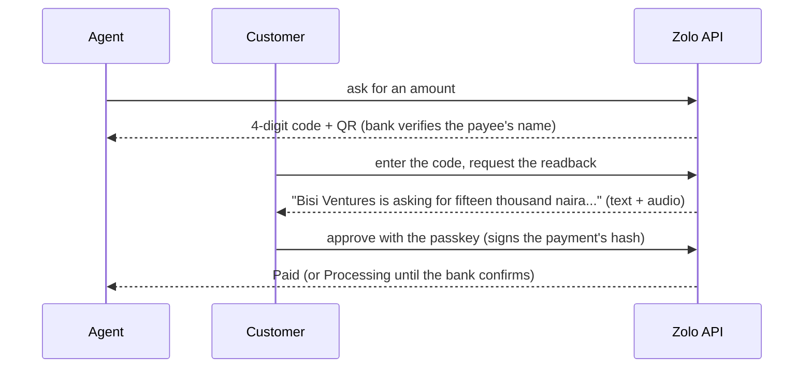

# Zolo

**Anyone can propose a payment. Only you can approve it.**

[](https://github.com/Techdee1/Zolo/actions/workflows/ci.yml)
[](https://github.com/Techdee1/Zolo/actions/workflows/frontend.yml)

Zolo is a consent layer for Zenith Bank, built for **blind and low-vision customers** who pay at an agent or a
POS. At a busy counter you cannot see the screen, so you have to trust what you are told. With Zolo the customer
**hears who is asking and how much**, then approves with their own passkey (fingerprint, face or screen lock).

Built for Zecathon 6.0, Track 7.

## Why it is safe

- **The passkey signs a hash of the exact payment.** If the amount or payee changes after the customer heard it,
  the hashes differ and nothing is sent (`INTENT_CHANGED`).
- **Nothing moves without approval,** a request expires after 2 minutes, and **a voice on its own can never
  approve** a payment.
- **No double payments:** every state change is one conditional database update, so two taps, two phones or a
  retry cannot approve or pay twice.
- **"Processing" is never "Paid":** if the bank has not confirmed, both screens say "Don't hand over goods yet".
- **The AI only proposes.** It cannot approve, execute or write the words a customer approves; any failure
  falls back to plain text and the keypad.

More: [`SECURITY.md`](SECURITY.md), [`docs/AI.md`](docs/AI.md), [`docs/DESIGN_DECISIONS.md`](docs/DESIGN_DECISIONS.md).

## How it works



The full design, state machine and component diagram are in [`docs/ARCHITECTURE.md`](docs/ARCHITECTURE.md).

## What is in the box

| Area | Highlights |
| --- | --- |
| **Backend** (`backend/`) | FastAPI + Postgres. Consent state machine, WebAuthn passkeys, mock bank behind an adapter, risk caps, append-only audit, RFC 9457 errors, rate limits, OpenAPI contract, 950 tests |
| **Frontend** (`frontend/`) | Next.js 16 PWA: landing page, customer and agent screens, demo console. WCAG 2.2 AA with axe at zero violations, strict CSP, springs and reduced-motion support |
| **Languages** | Screens and readback in English, Pidgin, Yoruba, Hausa and Igbo; the spoken readback falls back to English with a note when a recording does not exist |
| **Phone approval** | Optional (`FEATURE_PHONE_CALL`): a simulated call reads the payment out and the customer approves with a Zolo PIN, capped at ₦20,000. A lower-assurance channel, off by default; see [`docs/PRD_DEVIATIONS.md`](docs/PRD_DEVIATIONS.md) |
| **Voice** | Readback audio rendered in the background (YarnGPT), cached, with a shipped clip set for the demo amounts |
| **Deploy** | Render Blueprints (paid and free) and Docker Compose with automatic HTTPS |

## Run it locally

You need Docker (for Postgres), [`uv`](https://docs.astral.sh/uv/) and Node 24 with pnpm. `make help` lists
shortcuts.

```bash
# the API
cd backend
docker compose up -d postgres
cp .env.example .env            # set SESSION_SECRET, and DEMO_MODE=true with a DEMO_TOKEN
uv sync && uv run alembic upgrade head && uv run python -m zolo.seed
uv run uvicorn zolo.api.main:create_app --factory --port 8000

# the web app, in another terminal
cd frontend
pnpm install
cp .env.example .env.local      # BACKEND_URL defaults to http://localhost:8000
pnpm dev                        # http://localhost:3000
```

Open `http://localhost:3000`, tap "Try the demo", and sign in as the agent in one window and the customer in
another. Direct links that work on their own: `/signin`, `/home`, `/agent`, and `/demo` (the demo console, when
`NEXT_PUBLIC_FEATURE_DEMO=true`).

## Tests

| What | Command | Notes |
| --- | --- | --- |
| Backend | `cd backend && uv run pytest` | Needs Postgres. Coverage gate: 90% on `consent` and `passkeys` |
| Frontend: types, lint, unit | `cd frontend && pnpm check` | Includes the strict accessibility lint rules |
| Frontend: end to end and axe | `pnpm build:e2e && pnpm e2e` | Fake backend; light, dark and reduced motion |
| Frontend: real backend | `pnpm e2e:real` | Postgres and real WebAuthn verification with a software authenticator |

Strategy and counts: [`docs/TESTING.md`](docs/TESTING.md). CI runs all of this and also builds the Docker images.

## Deploy

- **Render:** [`docs/DEPLOY.md`](docs/DEPLOY.md), "On Render" (paid) or "On Render, free plan". New > Blueprint,
  pick this repo and `main`.
- **Your own machine:** the same guide, using `deploy/compose.yml`.

## Documentation

Start at [`docs/README.md`](docs/README.md). Highlights:
[Architecture](docs/ARCHITECTURE.md) · [Design decisions](docs/DESIGN_DECISIONS.md) ·
[Backend](docs/BACKEND.md) · [Frontend](docs/FRONTEND.md) · [AI](docs/AI.md) ·
[Security](SECURITY.md) · [Testing](docs/TESTING.md) · [Deploy](docs/DEPLOY.md) ·
[Real-phone test](docs/REAL_DEVICE_TEST.md) · [PRD deviations](docs/PRD_DEVIATIONS.md). The requirements are in [`Backend_PRD.md`](Backend_PRD.md),
[`Frontend_PRD.md`](Frontend_PRD.md), [`AI_PRD.md`](AI_PRD.md) and [`Engineering_Brief.md`](Engineering_Brief.md).

## Status and known limits

- **Languages:** Yoruba, Hausa and Igbo wording was natively reviewed and approved;
  the Pidgin wording has not been checked by a native speaker. A readback in Yoruba, Hausa or Igbo is spoken
  only when a recording of that exact sentence exists; otherwise the customer gets the English readback and an
  on-screen note, never an error.
- **Real phone:** the passkey flow has been run once on a real phone through a tunnel and worked, including the
  failure cases.
- **Demo scope:** mock login, mock bank, in-memory rate limiting (one process). See [`SECURITY.md`](SECURITY.md).

## License

MIT. See [`LICENSE`](LICENSE). Third-party material keeps its own licence (for example the design skill in
`.claude/skills/apple-design`, MIT, with its licence file).

## Contributing

See [`CONTRIBUTING.md`](CONTRIBUTING.md). Conventional commits; keys and `.env` files are never committed; the API
contract is [`backend/openapi.json`](backend/openapi.json) and CI fails if the frontend types drift from it.
