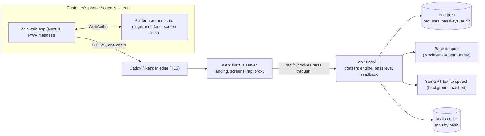
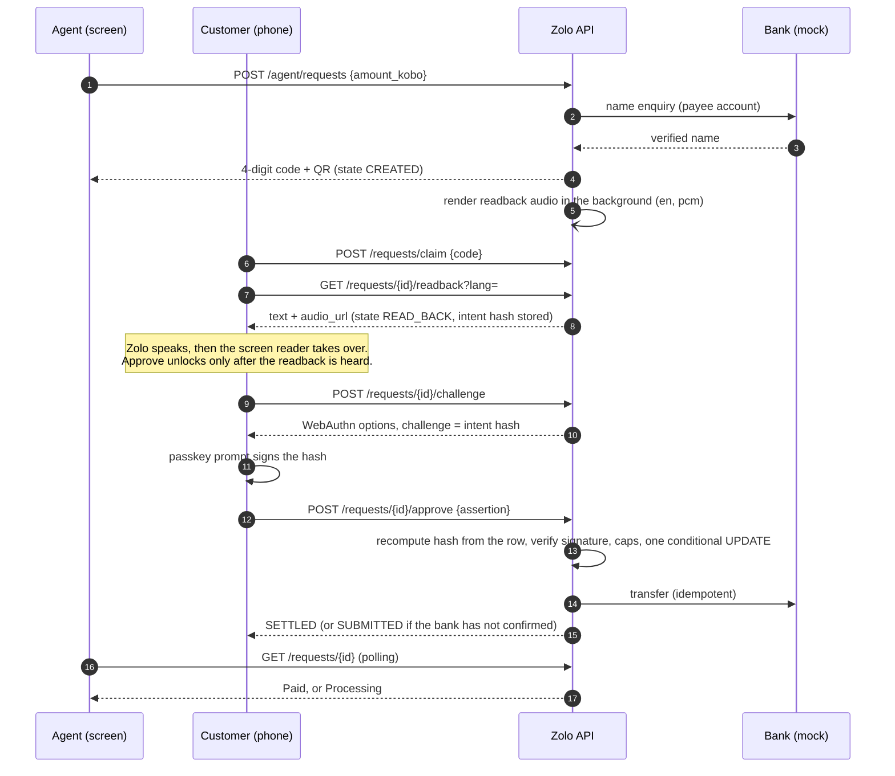
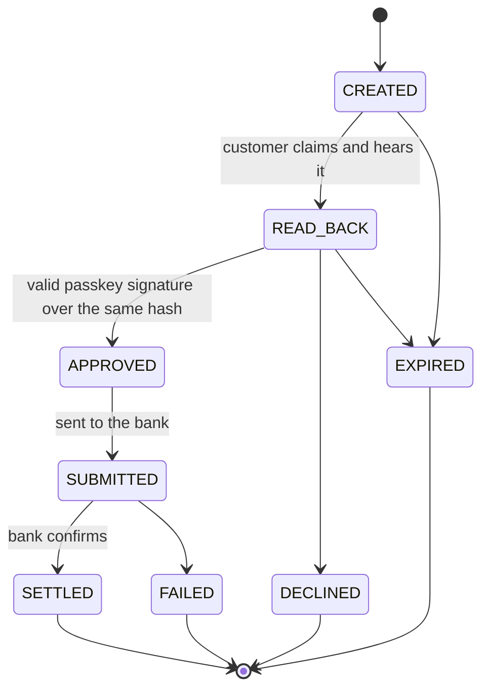

# Architecture and system design

## The idea in one sentence

A payment request is created by one person (the agent) and can only be completed by another (the
customer), and only after the customer has **heard exactly what they are approving** and proved it is
them with a passkey that signs a hash of that exact payment.

## System context



Why one origin: the browser only ever talks to the web app, which proxies `/api/*` to the backend. The
session is an `HttpOnly`, `SameSite=Lax` first-party cookie, there is no CORS surface, the CSP can say
`connect-src 'self'`, and the **WebAuthn origin and RP ID are the web app's domain**. See
[`DESIGN_DECISIONS.md`](DESIGN_DECISIONS.md#d1-the-browser-only-talks-to-the-web-app).

## The payment, end to end



## The request state machine



The table is in code (`backend/zolo/consent/machine.py`) and **every change is one conditional
`UPDATE ... WHERE state = :from`**. Two taps, two phones or a retry can never approve or pay twice: the
second finds zero rows and gets `STATE_CONFLICT`. `SUBMITTED` is a real, persistent state: the customer
approved but the bank call did not finish, so the UI says "Processing. Don't hand over goods yet." and
never "Paid".

## Backend modules (`backend/zolo/`)

| Module | Responsibility |
| --- | --- |
| `consent/` | **The only place that changes request state or calls `transfer`** (a test enforces it). Intent hash, state machine, readback text, audio lookup, the service that orchestrates approval |
| `passkeys/` | WebAuthn registration and assertion verification, challenge and credential storage. Verifies signatures; consent decides what they mean |
| `bank/` | `BankAdapter` protocol (name enquiry, transfer) and the mock. Swapping in a real bank changes one class |
| `risk/` | Plain rules over a request and history: per-payment cap and daily cap (Lagos calendar day) |
| `audit/` | Append-only audit events written in the same transaction as the change. Reason codes and ids only, never words or amounts in prose |
| `api/` | FastAPI routes, schemas, RFC 9457 errors, rate limiting, request logging, OpenAPI export |
| `ai/`, `voice/` | The speech and language package (see [`AI.md`](AI.md)): readback templates, TTS with a cache, STT, NLU. Not exposed over HTTP in Phase 1 apart from the readback audio |
| `demo/` | Seed data, reset, and the demo store; `routes_demo` is mounted only when `DEMO_MODE=true` |
| `agents/`, `core/` | Agent accounts, settings, security (signed sessions), models, errors, rate limiter |

## Data model (Postgres, Alembic migrations)

`customers`, `agents`, `bank_accounts` (and the mock bank's own `mock_accounts` / `mock_transfers`),
`saved_recipients`, `payment_requests` (state, amount in integer kobo, verified payee name, intent hash,
nonce, expiry), `passkey_credentials`, `webauthn_challenges`, `audit_events`, `risk_limits`,
`card_guard_windows` (Phase 3, unused). Money is an integer number of kobo everywhere; a database check
keeps `FAILED` rows explained and states to the known set.

## The intent hash (why a tampered payment cannot be approved)

The canonical intent is `{request, customer, payee account and bank, verified name, amount_kobo,
currency, nonce, expires_at}` serialised with sorted keys, no whitespace, integers only, UTC `Z` times and
an unpadded base64url nonce (`consent/intent.py`, version 1, pinned by golden fixtures). Its SHA-256 is
**the WebAuthn challenge**. On approve the server recomputes it from the database row, so if the amount
or payee changed after the readback the hashes differ and the answer is `INTENT_CHANGED`: nothing is sent.

## Frontend structure (`frontend/`)

```
app/page.tsx                 landing page (server component, no client JS of its own)
app/(app)/                   the app inside the phone-sized frame + live region
  signin  home  pay/code  requests/[id]  requests/[id]/result  setup/passkey  agent  demo
app/api/[...path]/route.ts   streaming proxy to the backend (no buffering, cookies pass through)
components/ui/               the kit: Button, AmountDisplay, Keypad, Badge, TimeLeft, Sheet, LiveRegion
lib/api/                     generated types + Zod schemas + one function per endpoint
lib/format/                  integer-only money formatting, amount in words
messages/                    en, pcm, yo, ha, ig (next-intl; no text in components)
proxy.ts                     per-request nonce CSP
```

Frontend state is deliberately thin: the server is the source of truth. The agent's page and the
customer's result page poll `GET /requests/{id}`; a dropped connection never changes what is on screen
and never claims failure for an approval whose outcome is unknown (it asks the server).

## Deployment shapes

- **Render Blueprint** (`render.yaml`): Postgres, a private API service with a disk for audio, a public
  web service. `render.free.yaml` is the free-plan variant (public API, no disk).
- **One machine** (`deploy/compose.yml`): Postgres, API, web, Caddy with automatic HTTPS.
- Both are demo deployments. Steps: [`DEPLOY.md`](DEPLOY.md).

## Where this stops (honest limits)

In-memory rate limiting (one process); mock bank and mock login; polling not server-sent events;
the AI voice-turn flow is built and tested but not exposed; Card Guard, renew and voice transfer are later
phases. See [`PRD_DEVIATIONS.md`](PRD_DEVIATIONS.md) for every place the build differs from the PRDs.
